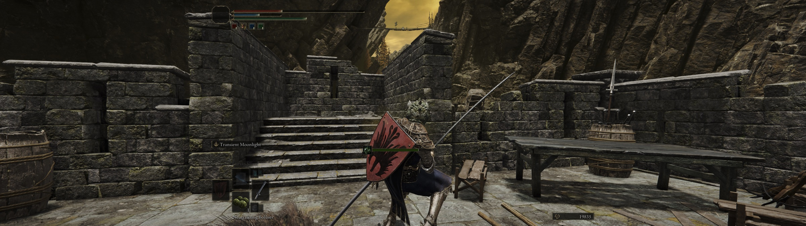

<h1 align="center">Elden Ring Ultrawide / Widescreen Fix for Samsung Odyssey Neo G9 on Mac (CrossOver)</h1>

<p align="center">
  <strong>True edge-to-edge 32:9 Elden Ring on a Samsung Odyssey Neo G9 (Neo9 / G95NC / G95SC) — or any super-ultrawide or 21:9 widescreen monitor — through CrossOver on macOS and Apple silicon.</strong>
</p>

<p align="center">
  
</p>

No black bars, no dark edges, no slow-motion NPCs at the sides, and no Flawless Widescreen.
Made for 57" (7680×2160) and 49" (5120×1440) Neo G9 / Odyssey G9 monitors and other 32:9 or
21:9 ultrawides on Apple silicon Macs with CrossOver 26 (D3DMetal / Game Porting Toolkit).
Tested on a 57" Neo G9 with an M5 Max — reports from other setups are welcome.

Based on [IgnazioDS/elden-ring-crossover-ultrawide](https://github.com/IgnazioDS/elden-ring-crossover-ultrawide),
which removes Elden Ring's 16:9 black bars at 21:9. On a 32:9 super-ultrawide that
alone is not enough — the bars stay, or the image only partly widens with dark sides.
This edition adds the missing pieces, found while getting it working on a
57" Odyssey Neo G9 (G95NC) with an M5 Max MacBook Pro.

> [!NOTE]
> The launcher starts the game directly rather than through the Easy Anti-Cheat
> launcher, which doesn't run under CrossOver anyway. Steam's **Play** button is untouched.

## What this edition fixes

| Problem on 32:9 | Cause | Fix in this edition |
|---|---|---|
| Menu shows 3840×1080 but the game still renders 16:9 with bars | Elden Ring only renders resolutions from a built-in 16:9 table; anything else silently falls back to 1920×1080 | The 1920×1080 table entry is rewritten to your resolution in the temporary copy |
| Sides look dark, like leftover bars | The vignette overlay is sized for 16:9 and darkens the outer thirds of a 32:9 image | Vignette disabled |
| NPCs at the sides move in slow motion | Anything outside the 16:9 view gets low-rate animation updates | Full-rate animation everywhere |
| Patched game closes after one second, or the stock game starts instead | Started outside Steam, the game asks Steam to relaunch it — through the anti-cheat launcher | Launcher creates `steam_appid.txt` |
| Game exits immediately from the CrossOver icon | Steam was not running in the bottle | Launcher starts Steam if needed and retries while it signs in |
| Different screens, or a laptop on its own | Resolution was hard-coded | Screen size is detected at each launch; on a 16:9/16:10 screen the game runs unpatched |
| Icon stops working after a game update | Patch locations were hard-coded per game version | Patches are found by byte pattern at every launch; if one is ever missing the game starts unpatched (16:9) and the log says why |

As in the original, the installed `eldenring.exe` is never modified. Each launch
patches a temporary copy, runs it, and deletes it on exit.

## Install

### Requirements

- A legitimate Steam copy of Elden Ring inside a CrossOver bottle
- A clean Steam `eldenring.exe` (tested on 1.17.1 and the October 2026 update; the installer checks the patch can be found)
- CrossOver 26.x on Apple silicon
- The game fully closed during installation

### Terminal

```sh
git clone https://github.com/kidtangerine/elden-ring-ultrawide-crossover-neo-g9.git
cd elden-ring-ultrawide-crossover-neo-g9
./scripts/install.command
```

The resolution is detected each time you launch: the screen size CrossOver reports
(the "looks like" size in System Settings → Displays, with CrossOver's High
Resolution Mode off) — e.g. `3840x1080` on a 57" Neo G9 at default scaling,
`5120x1440` on a 49" G9, `3440x1440` at 21:9. To force a size, install with
`--resolution 3840x1080` (or edit `C:\EldenRingTools\resolution.txt` in the bottle).

On a screen that is not wider than 16:9 — for example a MacBook with the external
monitor unplugged — the launcher runs the game unpatched, so the same icon works everywhere.

If more than one bottle contains Elden Ring, add `--bottle "/full/path/to/bottle"`.

### Play

1. Click the **ELDEN RING** icon in CrossOver (Steam starts automatically if it isn't running).
2. In-game: **System → Graphics → Screen Resolution** → choose your ultrawide resolution
   (once). It replaces the 1920×1080 slot in the list, so the same saved setting gives
   ultrawide on the wide screen and normal 1920×1080 on a laptop screen. Screen mode **Borderless** is recommended.

## Diagnose or uninstall

```sh
./scripts/diagnose.command
./scripts/uninstall.command
```

Uninstall restores the original shortcuts and removes the launcher, `resolution.txt`
and `steam_appid.txt`. The launcher log is `C:\EldenRingTools\elden-ring-ultrawide.log`
inside the bottle; a healthy launch looks like:

```text
screen 3840x1080: bars at 0x19EE74E, 1920x1080 entry -> 3840x1080, vignette off, full-rate animation
```

## Known limitations

- **Loading screens show junk at the sides.** Loading screens, including the ones when the game
  starts and when you quit, draw their artwork at 16:9 and never clear the rest of the screen, so the
  side strips show a half-loaded, low-detail world (bare cliffs, flat water). It's annoying, but
  harmless: it disappears as soon as the area loads, and gameplay and cutscenes are full width.
  No patch for this exists yet; contributions welcome.
- **Map and site-of-grace fade are 16:9.** The map is a 16:9 panel with your live game visible
  on both sides, and the fade when resting or traveling only darkens the 16:9 centre. Cosmetic;
  tracked with the loading screens in [#1](https://github.com/kidtangerine/elden-ring-ultrawide-crossover-neo-g9/issues/1).
- **Performance:** 3840×1080 is twice the pixels of 1080p. On an M5 Max it held 60 FPS
  (GPU ~7 ms/frame) at High; slower Macs may need lower settings.
- **Game updates:** patches are located by pattern, so updates that only move code keep working.
  If an update changes the patched code itself, the game starts unpatched (16:9) and the log says why.

## Supported build

| Component | Verified value |
|---|---|
| Elden Ring | Steam 1.17.1 and the October 2026 update (build 25827938) |
| CrossOver | 26.3 |
| Mac | MacBook Pro 16" M5 Max |
| Display | Samsung Odyssey Neo G9 57" (G95NC), 3840×1080 @ 32:9 |

## How the launch works

```text
CrossOver ELDEN RING icon
        ↓
Launcher (C:\EldenRingTools) — finds each patch by byte pattern (must match exactly once)
        ↓
Temporary copy: bar-removal branch (74 4F 45 8B 94 CC: 74→EB)
                1920×1080 table entry → your resolution
                vignette multiply → zero
                animation-distance divide → zero
        ↓
steam_appid.txt present, Steam running → start the copy
        ↓
Game exits → temporary files deleted
```

## Build

The launcher source is [`src/EldenRingUltrawideLauncher.cs`](src/EldenRingUltrawideLauncher.cs)
(.NET Framework 4.8). Build with `dotnet build src/EldenRingUltrawideLauncher.csproj -c Release`.
The bundled `dist/EldenRingUltrawideLauncher.exe` checksum is in
[`dist/SHA256SUMS.txt`](dist/SHA256SUMS.txt) and is verified by the installer.

## Credits

- [IgnazioDS/elden-ring-crossover-ultrawide](https://github.com/IgnazioDS/elden-ring-crossover-ultrawide) —
  the CrossOver launcher, installer, temporary-copy design and rollback tooling this edition is built on (MIT).
- [gurrgur/er-patcher](https://github.com/gurrgur/er-patcher) — black-bar, vignette and animation-distance patches (MIT).
- [uberhalit/EldenRingFpsUnlockAndMore](https://github.com/uberhalit/EldenRingFpsUnlockAndMore) —
  the custom-resolution table technique (MIT).

Elden Ring is a trademark of its respective owners. CrossOver is a trademark of
CodeWeavers. This independent community project is not affiliated with or endorsed
by FromSoftware, Bandai Namco, Valve, CodeWeavers or Samsung. No game files are distributed.

Released under the [MIT License](LICENSE).
